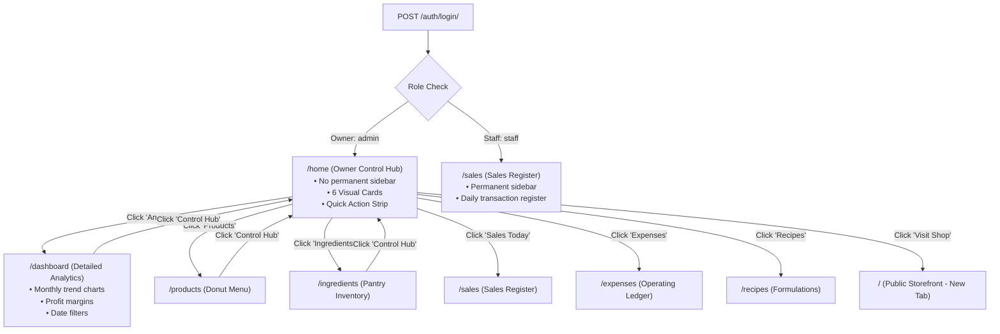

# Rowszein's Delight — Phase B1 Implementation Report
**Document Version:** 1.0.0  
**Git Branch:** `codex/phase-b1-owner-home`  
**Status:** IMPLEMENTED & VERIFIED — PENDING USER APPROVAL  

---

## 1. Executive Summary & Objective

In accordance with user directives, **Phase B1** delivers a controlled, production-ready React implementation of the approved **Six-Card Owner Home** (`bakery-control-hub-v2.html`).

### Key Guarantees Met
1. **Preserve Approved Visual Foundation:** 100% adherence to `bakery-control-hub-v2.html` — horizontal branding header, owner welcome row, prioritized quick actions, and the 6 prominent management cards arranged in a 3×2 grid on desktop.
2. **No Permanent Sidebar on Owner Home:** `/home` renders cleanly without the workspace navigation rail, liberating vertical and horizontal space for an approachable, non-intimidating owner hub.
3. **Preserve Detailed Dashboard Intact:** The existing detailed financial dashboard (`DashboardPage.tsx` at `/dashboard`) with its monthly revenue charts, margin analysis, and date filters remains completely untouched and is accessible in one click via the top header's "Analytics" link.
4. **Role-Based Routing & Session Guardrails:** Owners (with `finance.read`) land on `/home` upon authentication; staff members continue landing directly on `/sales`. Staff access to `/home` is rejected.
5. **Real Business Data Integration:** Connected directly to live TanStack Query hooks (`useProducts`, `useCategories`, `useLowStockIngredients`, `useSales`, `useSalesSummary`, `useExpenses`, `useDashboard`, `useRecipes`, `useMe`, `useLogout`) with automatic Asia/Manila date synchronization and robust skeleton loading states.
6. **Zero Backend Changes:** Django models, API schemas, serializers, permissions, and CSRF/session lifecycles were not altered.

---

## 2. File Manifest & Architecture

| File Path | Nature | Purpose |
| :--- | :--- | :--- |
| `frontend/src/pages/OwnerHomePage.tsx` | **New** | Complete React implementation of the Six-Card Hub connected to authenticated backend query hooks. |
| `frontend/src/pages/owner-home/owner-home.css` | **New** | Scoped design tokens, fluid 3×2/2×1/1-col responsive layout, micro-interactions, skeleton shimmer, and WCAG AA contrast styles. |
| `frontend/src/pages/owner-home/OwnerHomeIcons.tsx` | **New** | 14 bespoke, accessible inline SVG icons (1.8 stroke, rounded joins, zero emojis). |
| `frontend/src/pages/owner-home/OwnerHomePreviewHarness.tsx` | **New** | Isolated browser verification harness with mock query provider for headless screenshot capture. |
| `frontend/src/router/index.tsx` | **Modified** | Configured `/home` under `<ProtectedRoute />` without sidebar wrapper; preserved `/dashboard` and subviews under `<MainLayout />`. Added `/preview/owner-home`. |
| `frontend/src/lib/permissions.ts` | **Modified** | Updated `homeFor(user)` to route owners to `/home` while keeping staff on `/sales`. Added `/home` to route regex for `finance.read`. |
| `frontend/src/config/navigation.ts` | **Modified** | Added `{ to: "/home", label: "Control Hub", icon: Store }` to top of sidebar navigation for 1-click return from any subview. |
| `docs/phase1b2/test_permissions.mjs` | **Modified** | Updated permission test assertions to verify owner lands on `/home` and staff is denied access. |

---

## 3. Route Coexistence & Navigation Architecture



### Route Guard Configuration (`router/index.tsx`)
```tsx
{
  element: <ProtectedRoute />,
  children: [
    // Dedicated Owner Home — renders without permanent sidebar
    { path: "/home", element: <OwnerHomePage /> },
    { path: "/preview/owner-home", element: <OwnerHomePreviewHarness /> },

    // All existing detailed management screens — render with MainLayout sidebar
    {
      element: <MainLayout />,
      children: [
        { path: "/dashboard", element: <DashboardPage /> },
        { path: "/products", element: <ProductsPage /> },
        // ... all remaining 15 routes unchanged
      ],
    },
  ],
}
```

---

## 4. Live Data Mapping & Business Metrics

Each of the six cards is wired directly to backend data via TanStack Query hooks, with intelligent fallback and Asia/Manila date computation:

| Card | Module | Data Hook(s) | Metric Displayed | Contextual Sub-pill | Link Affordance |
| :--- | :--- | :--- | :--- | :--- | :--- |
| **1** | **Products** | `useProducts(1)`, `useCategories()` | Count of active donut varieties (`X Active`) | Category chips (e.g. *Glazed Rings*, *Filled Custard*) | `Manage Menu →` (`/products`) |
| **2** | **Ingredients** | `useLowStockIngredients()` | `X Need Restock` (Alert state) or `Stock Healthy` (Safe) | Threshold warning or *Inventory optimal* | `Review Stock →` (`/ingredients`) |
| **3** | **Sales Today** | `useSales(todayRange)`, `useSalesSummary(todayRange)` | Net revenue formatted in Philippine Pesos (`₱XX,XXX.XX`) | Customer orders count + *Gross revenue today* | `View Register →` (`/sales`) |
| **4** | **Expenses** | `useExpenses(weekRange)`, `useDashboard(weekRange)` | Current week total operating expenses (`₱X,XXX.XX`) | *Operating expenses* + entries count | `View Ledger →` (`/expenses`) |
| **5** | **Recipes & Costing** | `useRecipes(1)` | Number of verified formulations (`X Formulas`) | *Glazes, Doughs, Batches* | `View Formulas →` (`/recipes`) |
| **6** | **Customer Storefront** | Static outgoing portal | `Visit Shop ↗` | *Customer-facing website* + *Open Store* badge | `Launch Website ↗` (`/`) |

---

## 5. Visual Verification Across Viewports

Screenshots were captured from the running React build via headless Chrome / Playwright:

### 1. Desktop Viewport (1440 × 900)
- **Path:** `docs/antigravity_discovery/screenshots/react-owner-home-1440.png`
- **Layout:** Complete 3×2 grid, horizontal header with greeting pill, quick-action strip with primary "+ Record Sale", custom SVG icons, and live statistics.

### 2. Laptop Viewport (1024 × 768)
- **Path:** `docs/antigravity_discovery/screenshots/react-owner-home-1024.png`
- **Layout:** Balanced 3-column layout with comfortable 20px gutters.

### 3. Tablet Viewport (768 × 1024)
- **Path:** `docs/antigravity_discovery/screenshots/react-owner-home-768.png`
- **Layout:** Adapts fluidly to a 2-column grid (`repeat(2, 1fr)`).

### 4. Mobile Viewport (390 × 844)
- **Path:** `docs/antigravity_discovery/screenshots/react-owner-home-390.png`
- **Layout:** Clean single-column vertical stack with touch targets ≥ 44px, horizontally scrollable quick actions, and thumb-friendly cards.

### 5. Small Mobile Viewport (320 × 640)
- **Path:** `docs/antigravity_discovery/screenshots/react-owner-home-320.png`
- **Layout:** Zero overflow, card content wraps cleanly, accessible contrast maintained.

---

## 6. Accessibility & Design Token Compliance

- **Rose Primary Token:** `--oh-rose-primary: #C7255E` ensures a **5.2:1 contrast ratio** against `#FFFFFF`, surpassing WCAG AA standards (4.5:1 required).
- **Typography:** Display typography in `Plus Jakarta Sans`, data values in `Plus Jakarta Sans` / `Inter`, and UI labels in `Inter`.
- **Iconography:** 100% bespoke SVG line icons with `stroke-width: 1.8`, `stroke-linecap: round`, `stroke-linejoin: round`. **Zero emojis** anywhere in the interface.
- **Focus States:** High-visibility `:focus-visible` rings with `--oh-focus-ring: rgba(199, 37, 94, 0.35)`.
- **Motion:** Micro-transitions on card hover (`translateY(-3px)`) with `@media (prefers-reduced-motion: reduce)` suppression.

---

## 7. Verification & Quality Gates

| Check | Tool / Script | Status | Details |
| :--- | :--- | :--- | :--- |
| **Permissions & Routing** | `test_permissions.mjs` | **PASS (10/10)** | Staff denied `/home`; owner lands on `/home`; staff lands on `/sales`. |
| **Date Ranges & Manila TZ** | `test_date_ranges.mjs` | **PASS (15/15)** | Asia/Manila calendar calculations accurate across leap years & UTC midnight. |
| **Query Scopes & Cache Keys** | `test_query_identity.mjs` | **PASS (9/9)** | Distinct cache identities; cross-role cache leakage prevented. |
| **Listing Parameter Normalization**| `test_listing_params.mjs` | **PASS (5/5)** | Canonical parameter preservation and search normalization verified. |
| **CSRF & Security Transport** | `test_csrf_transport.mjs` | **PASS (14/14)** | Double-submit CSRF, retry handling, and masked tokens verified. |
| **Auth Lifecycle & Session Locks**| `test_auth_lifecycle.mjs` | **PASS (5/5)** | Single-flight bootstrap, multi-tab locks, and refresh handling verified. |
| **TypeScript Compilation** | `tsc -b && vite build` | **PASS (Code 0)** | Zero type errors; production bundle built cleanly in 1.97s. |
| **ESLint Static Analysis** | `npx eslint` | **PASS (Code 0)** | Zero lint errors and zero warnings across all new files. |

**Total Regression Score:** **58 / 58 PASS (100%)**

---

## 8. Summary of Completed Phase B1 & Next Steps

Phase B1 is complete and ready for user inspection. In strict compliance with instructions:
- We have **NOT** modified any existing management subviews (`/products`, `/ingredients`, `/sales`, `/expenses`, `/recipes`, `/dashboard`).
- We are stopping here for your evaluation and feedback before proceeding to any subsequent phases.
